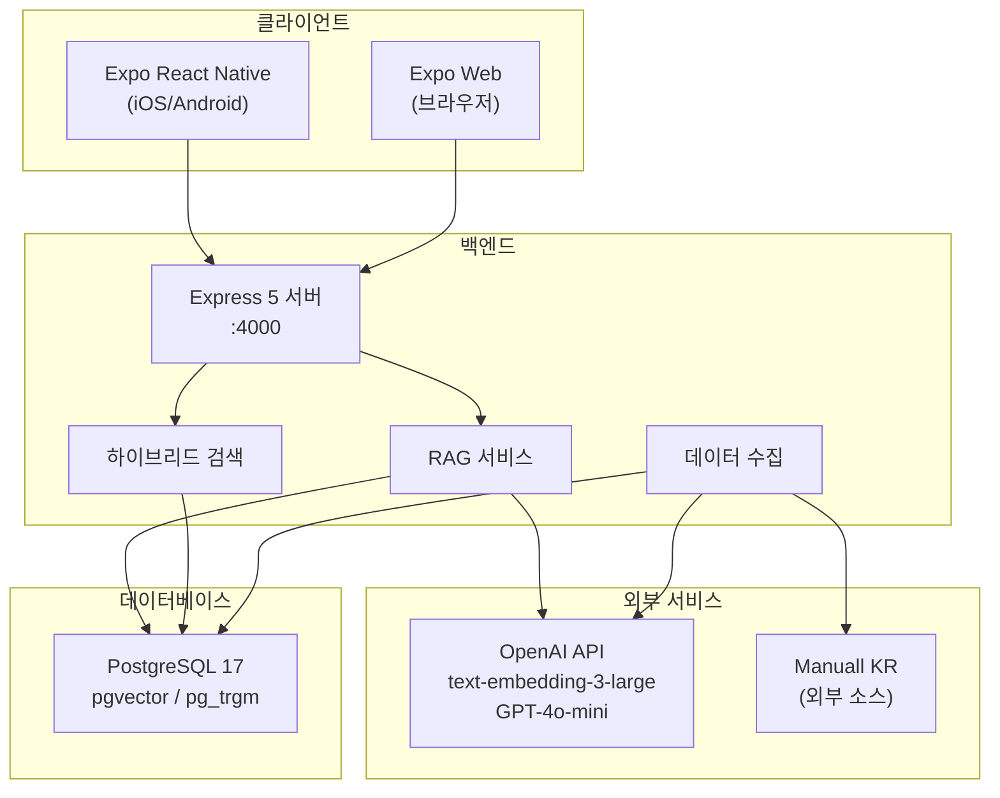

# 세라프(Seraph) 시스템 아키텍처

이 문서는 세라프 프로젝트의 전반적인 시스템 아키텍처, 데이터 흐름, 기술적 설계 결정 및 보안 고려사항을 설명합니다.

## 1. 시스템 개요

세라프는 3-tier 구조로 구성되어 있으며, 각 계층은 다음과 같이 역할을 수행합니다:
1.  **프론트엔드 (Client):** Expo React Native(iOS/Android) 및 Expo Web(브라우저)을 통해 사용자 인터페이스 제공
2.  **백엔드 API (Server):** Express 5 기반의 서버로, 비즈니스 로직, RAG 파이프라인, 하이브리드 검색 및 외부 데이터 수집 처리
3.  **데이터베이스 (Database):** PostgreSQL 17 및 pgvector 확장을 사용하여 릴레이션 데이터와 벡터 임베딩 저장

## 2. 시스템 아키텍처 다이어그램

## 3. 주요 데이터 흐름

### A. 사용자 질문-답변 흐름 (RAG)

사용자가 질문을 입력하고 AI 기반의 답변을 얻는 과정은 다음과 같습니다.

1.  **사용자가 질문 입력**
2.  **`POST /api/chat/ask` 호출**
3.  **질문 임베딩 생성:** OpenAI `text-embedding-3-large` 모델을 사용하여 질문 텍스트를 1024차원 벡터로 변환
4.  **하이브리드 검색 수행:**
    *   **pgvector HNSW 코사인 유사도 검색:** 벡터 기반 의미 기반 검색 (Top 30)
    *   **PostgreSQL 전문 검색:** `ts_rank` + `ILIKE` 가중치를 활용한 키워드 검색 (Top 30)
    *   **RRF (Reciprocal Rank Fusion) 통합 랭킹:** 두 검색 결과를 결합 (score = 1.0 / (60 + rank))
5.  **상위 청크 컨텍스트 구성:** RRF 상위 결과를 바탕으로 LLM에 제공할 프롬프트 컨텍스트 구성
6.  **답변 생성:** OpenAI `GPT-4o-mini` 모델을 사용하여 답변 생성 (JSON 모드 활용)
7.  **결과 반환 및 저장:** 생성된 답변과 참조 출처(citations)를 반환하고, 채팅 세션 기록을 DB에 저장

### B. 설명서 카테고리 탐색

사용자가 설명서 카테고리를 탐색하는 과정입니다.

1.  **`GET /api/categories` 호출:** 계층적 카테고리 트리 데이터 조회
2.  **프론트엔드 드릴다운:** 대분류 → 소분류 → 제조사 순으로 단계별 탐색
3.  **목록 표시:** 선택한 카테고리/제조사에 해당하는 설명서 목록 표시

### C. 데이터 수집 파이프라인

외부 소스에서 설명서 데이터를 수집하고 처리하는 파이프라인입니다.

1.  **외부 소스 등록 및 권한 관리**
2.  **카테고리 메타데이터 수집**
3.  **설명서 후보 수집 및 승격:** 원시 데이터를 수집 후 검토를 거쳐 정식 설명서 데이터로 승격
4.  **PDF 텍스트 추출:** `pdftotext` 유틸리티를 사용하여 PDF에서 텍스트 추출
5.  **구조 분석:** 목차 파싱 및 장/절 구조 복원
6.  **시맨틱 청킹:** 경고/참고/절차/문제해결 등의 논리적 구조를 인식하여 청킹 수행 (목표: 450 토큰, 최대: 720 토큰, 오버랩: 80 토큰)
7.  **임베딩 생성:** 추출된 텍스트 청크에 대해 배치(batch) 단위로 임베딩 생성 및 저장

## 4. 기술적 설계 결정

*   **ORM 미사용:** `pg` 패키지를 사용하여 직접 SQL 쿼리를 작성함으로써 성능을 최적화하고 벡터 연산(HNSW 등)에 대한 세밀한 제어 확보
*   **Zod 런타임 검증:** API 요청 및 응답 데이터 스키마를 엄격하게 검증하여 데이터 안정성 보장
*   **OpenAI 선택적 의존:** OpenAI API 키가 없는 환경(또는 장애 시)에서도 PostgreSQL 내장 기능(전문 검색, `pg_trgm`)을 활용한 키워드 검색으로 폴백(Fallback) 가능하도록 설계
*   **RRF 하이브리드 검색:** 벡터 검색(의미)과 키워드 검색(정확도) 결과를 RRF 방식으로 통합하여 최적의 검색 결과 제공
*   **시맨틱 청킹 (Semantic Chunking):** 단순한 글자 수 기반이 아닌, 문서의 논리적 구조(경고, 참고, 절차 등)를 유지하는 청킹 기법 적용
*   **pgvector HNSW 인덱스:** 기존 IVFFlat 방식 대비 리콜율(Recall)이 높고 인덱스 구축 즉시 사용할 수 있는 HNSW 인덱스 활용
*   **채팅 세션 관리:** 대화 이력을 데이터베이스에 저장하여, 이후 질문 시 이전 맥락(Context)을 유지한 답변 제공

## 5. 보안 고려사항

*   **Docker 비루트 사용자 실행:** 보안 강화를 위해 컨테이너 내부 프로세스는 비루트(`USER node`) 권한으로 실행
*   **CORS 통제:** 화이트리스트 기반의 CORS 설정(`CORS_ORIGINS`)을 통해 허용된 출처의 요청만 수락
*   **프록시 신뢰 설정 (`TRUST_PROXY`):** 리버스 프록시(Nginx, Traefik 등) 환경에서 클라이언트의 실제 IP를 정확하게 식별하기 위한 설정 적용
*   **외부 데이터 수집 권한 거버넌스:** 데이터 수집 시 저작권 및 스크래핑 정책(`source_sites.rights_status`)을 고려한 권한 관리 프로세스 구축
*   **환경변수 검증:** 프로덕션 환경 구동 시 필수 환경변수(`DATABASE_URL`, `CORS_ORIGINS` 등) 존재 여부를 엄격하게 검증하여 설정 누락으로 인한 문제 사전 차단
