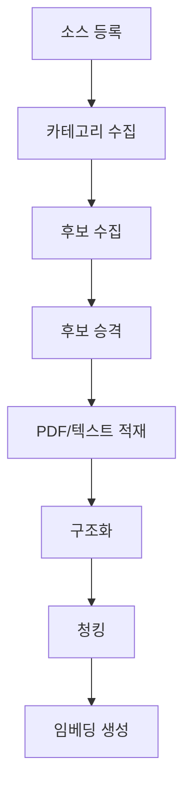

# Seraph 데이터 수집 파이프라인

## 1. 개요
외부 설명서 소스에서 데이터를 수집하고, RAG 검색이 가능한 형태로 가공하는 파이프라인입니다.

## 2. 전체 파이프라인 흐름

## 3. 데이터 거버넌스
- `source_sites` 테이블로 외부 소스 관리
- `rights_status`: `needs_permission` → `allowed`/`licensed`/`blocked`
- `import_policy`: `metadata_only` → `licensed_full_text`/`official_full_text`/`blocked`
- 권한 변경 시 `source_rights_events`에 이력 기록
- `allowed` 또는 `licensed`로 변경 시 증빙 URL (`license_url` 또는 `permission_document_url`) 필수

## 4. 수집 스크립트

### 4-1. 카테고리 수집 (`manuall.ts`)
- Manuall KR 웹사이트에서 카테고리 메타데이터 수집
- `source_categories` 테이블에 저장
- `import_policy = 'metadata_only'`일 때만 동작
- Cloudflare 차단 시 `import_jobs.status = 'blocked'`
- 실행: `npm run import:manuall:categories [--dry-run]`

### 4-2. 설명서 후보 수집 (`manualCandidates.ts`)
- JSON/JSONL 파일에서 후보 데이터 읽기
- `manual_import_candidates` 테이블에 적재
- 실행: `npm run import:manual-candidates -- --source="Manuall KR" --file=path`

### 4-3. 후보 승격 (`promoteManualCandidates.ts`)
- `discovered` 상태 + 카테고리 매핑 `confirmed` + 차단 아닌 후보 대상
- `manuals` 테이블로 메타데이터 승격 (`ingestion_status = 'pending'`, `rights_status = 'unknown'`)
- 본문은 권한 확보 전까지 적재하지 않음
- 실행: `npm run import:manual-candidates:promote -- --source="Manuall KR" --limit=100`

### 4-4. 텍스트 임포터 (`manualText.ts`)
- JSON/JSONL 형식 페이지별 텍스트 데이터 처리
- 트랜잭션으로 `manuals`, `manual_revisions`, `manual_pages`, `manual_sections`, `manual_chunks`, `manual_applicability`에 원자적 적재
- 실행: `npm run import:manual-text -- --file=path`

### 4-5. PDF 임포터 (`manualPdf.ts`)
- `pdftotext`/`pdfinfo` CLI로 텍스트/메타데이터 추출
- SHA-256 해시 계산
- `manualStructure.ts`로 구조화:
  - 목차(TOC) 파싱 및 섹션 트리 구축
  - 헤더/푸터 제거
  - 콘텐츠 분류 (`overview`, `procedure`, `warning`, `note`, `troubleshooting`, `reference`)
  - 시맨틱 청킹 (목표 450토큰, 최대 720토큰, 80토큰 오버랩)
  - 임베딩 콘텐츠 생성 (제목 + 버전 + 목차 경로 접두사)
- 실행: `npm run import:manual-pdf -- --file=path`

### 4-6. 임베딩 생성 (`embedManualChunks.ts`)
- `embedding`이 없는 `manual_chunks` 배치 처리 (기본 64개)
- OpenAI `text-embedding-3-large`, 1024차원
- `--dry-run` 지원
- 실행: `npm run embed:manual-chunks [--dry-run]`

## 5. 수집 작업 추적
- `import_jobs` 테이블에 모든 수집 작업 이력 기록
- `job_type`: `discover_categories`, `discover_manuals`, `ingest_pdf_text`, `sync_metadata`, `embed_manual_chunks`
- `status`: `queued`, `running`, `succeeded`, `failed`, `blocked`
- `found_count`, `imported_count`, `skipped_count` 통계 제공

## 6. Manuall 데이터 수집 방침
- 현재 Manuall은 `metadata_only`, `needs_permission` 상태
- **허가 전**: 카테고리 및 URL 후보만 저장
- **허가 후**: PDF 저장, 텍스트 추출, 청크/임베딩 생성 가능
