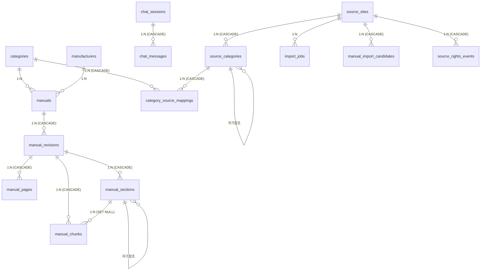

# 데이터베이스 스키마

이 문서는 시스템의 데이터베이스 스키마, 테이블 구조, 인덱스 전략, 검색 및 상태 값(Enum)에 대한 상세 정보를 제공합니다.

## ER 다이어그램

## 테이블 목록 (총 18개)

### 핵심 및 설명서 데이터
1. **categories**: 내부 카테고리 트리 
   - `uuid` PK, `parent_id` 자기참조, `depth` 1~3, `slug`, `slug_path` UNIQUE, `sort_order`
2. **manufacturers**: 제조사 
   - `uuid` PK, `name` UNIQUE, `slug` UNIQUE, `country_code`, `website_url`
3. **manuals**: 설명서 마스터 
   - `uuid` PK, `category_id` FK, `manufacturer_id` FK, `title`, `model_name`, `normalized_model`, `language_code`, `source_url`, `pdf_url`, `storage_path`, `source_type` CHECK, `ingestion_status` CHECK, `rights_status` CHECK, `summary`, `search_vector` tsvector GENERATED
4. **manual_revisions**: 설명서 판본 
   - `uuid` PK, `manual_id` FK CASCADE, `revision_key`, `version_label`, `software_version`, `file_sha256` CHECK regex, `file_size_bytes`, `page_count`, `ingestion_status` CHECK, `embedding_status` CHECK, UNIQUE(`manual_id`, `revision_key`, `language_code`)
5. **manual_applicability**: 적용 제품/모델 
   - `uuid` PK, `revision_id` FK CASCADE, `product_name`, `model_name`, `software_version`
6. **manual_pages**: 페이지별 원문 
   - `uuid` PK, `manual_id` FK CASCADE, `revision_id` FK CASCADE, `page_number` CHECK >0, `text_content`, `printed_page_label`, `is_embeddable`, `layout_metadata` jsonb
7. **manual_sections**: 목차/장절 구조 
   - `uuid` PK, `revision_id` FK CASCADE, `parent_id` 자기참조, `section_key`, `level` 1~6, `ordinal`, `title`, `page_start`, `page_end`
8. **manual_chunks**: RAG 청크 
   - `uuid` PK, `manual_id` FK, `revision_id` FK, `section_id` FK, `page_start`, `page_end`, `chunk_index`, `content`, `embedding_content`, `content_type` CHECK, `content_hash`, `embedding` vector(1024), `embedding_model`, `search_vector` tsvector GENERATED

### 채팅 및 요청
9. **chat_sessions**: 채팅 세션 
   - `uuid` PK, `title`, `client_id`
10. **chat_messages**: 채팅 메시지 
   - `uuid` PK, `session_id` FK CASCADE, `role` CHECK, `content`, `citations` jsonb
11. **contact_requests**: 문의 
   - `uuid` PK, `email`, `subject`, `message`, `status` CHECK
12. **manual_requests**: 설명서 요청 
   - `uuid` PK, `product_name`, `manufacturer_name`, `model_name`, `status` CHECK

### 외부 소스 및 수집 데이터
13. **source_sites**: 외부 소스 
   - `uuid` PK, `name` UNIQUE, `base_url` UNIQUE, `import_policy` CHECK, `rights_status` CHECK, `license_url`, `permission_document_url`
14. **source_categories**: 소스 카테고리 
   - `uuid` PK, `source_site_id` FK CASCADE, `parent_id` 자기참조, `source_slug_path`, `name`, `depth` 1~4, `category_kind` CHECK
15. **category_source_mappings**: 카테고리 매핑 
   - `uuid` PK, `category_id` FK CASCADE, `source_category_id` FK CASCADE, `confidence` numeric(4,3), `mapping_status` CHECK
16. **import_jobs**: 수집 작업 
   - `uuid` PK, `source_site_id` FK, `job_type` CHECK, `status` CHECK, `requested_mode` CHECK, `found`/`imported`/`skipped` count
17. **manual_import_candidates**: 설명서 후보 
   - `uuid` PK, `source_site_id` FK CASCADE, `source_category_id` FK, `manual_id` FK, `candidate_status` CHECK, `rights_status` CHECK, `import_mode` CHECK
18. **source_rights_events**: 권한 변경 이력 
   - `uuid` PK, `source_site_id` FK CASCADE, `previous/new import_policy`, `previous/new rights_status`, `license_url`, `reason`

## 인덱스 (총 30개 주요 인덱스)
- **HNSW**: `manual_chunks.embedding` (`vector_cosine_ops`, `WHERE embedding IS NOT NULL`)
- **GIN**: 
  - `search_vector` (`manuals`, `manual_chunks`)
  - `content gin_trgm_ops` (`manual_chunks`)
  - `title tsvector` (`manual_import_candidates`)
- **Partial**: 
  - `manual_candidates promoted WHERE false`
  - `manual_revisions file_sha256 WHERE NOT NULL`
  - `manuals source_url WHERE NOT NULL`

## 벡터 검색 및 pgvector 설정
- **Vector 타입**: `vector(1024)` 사용
- **인덱스**: HNSW 인덱스 (`vector_cosine_ops` 옵션)
- **검색 함수**: `match_manual_chunks()`를 통한 코사인 유사도 검색 (`1 - (embedding <=> query_embedding)`)

## 전문 검색 (Full-text Search) 설정
- **manuals.search_vector**: `simple` 딕셔너리 사용, `title(A)` + `model_name(A)` + `normalized_model(A)` + `summary(B)`
- **manual_chunks.search_vector**: `simple` 딕셔너리 사용, `content`
- **pg_trgm**: `manual_chunks.content`에 `gin_trgm_ops` 인덱스 적용

## Enum 값 (TEXT CHECK 제약조건)
테이블 내 TEXT 필드에 CHECK 제약조건으로 관리되는 Enum 값 목록입니다.

- **Source Type**: `official`, `partner`, `user_upload`, `sample`
- **Ingestion Status**: `pending`, `processing`, `parsed`, `embedding`, `ready`, `failed`
- **Rights Status**: `unknown`, `needs_permission`, `allowed`, `licensed`, `user_provided`, `blocked`
- **Import Policy**: `metadata_only`, `licensed_full_text`, `official_full_text`, `blocked`
- **Category Kind**: `department`, `product_type`, `manufacturer`, `model_collection`, `category`
- **Mapping Status**: `suggested`, `confirmed`, `rejected`
- **Job Type**: `discover_categories`, `discover_manuals`, `ingest_pdf_text`, `sync_metadata`, `embed_manual_chunks`
- **Candidate Status**: `discovered`, `mapped`, `imported`, `skipped`, `blocked`
- **Content Type**: `overview`, `procedure`, `warning`, `note`, `troubleshooting`, `reference`, `visual`
- **Chat Role**: `user`, `assistant`, `system`
