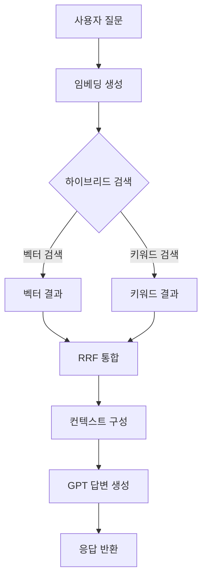

# Seraph RAG 파이프라인

## 1. 개요
세라프의 RAG(Retrieval-Augmented Generation) 파이프라인은 사용자의 자연어 질문에 대해 설명서 근거를 찾아 답변을 생성합니다.

## 2. 전체 흐름

## 3. 임베딩
- **모델**: OpenAI `text-embedding-3-large`
- **차원**: 1024
- **배치 처리**: `embedManualChunks.ts` (기본 64개씩)
- `embedding_content`에 문서 제목, 소프트웨어 버전, 목차 경로 메타데이터 포함

## 4. 하이브리드 검색
### 벡터 검색
- pgvector HNSW 인덱스 사용
- 코사인 유사도: `1 - (embedding <=> query_embedding)`
- Top 30 결과 추출

### 키워드 검색
- PostgreSQL `tsvector` + `plainto_tsquery('simple', ...)`
- `ILIKE` 패턴 가중치 적용
- Top 30 결과 추출

### RRF 통합 (Reciprocal Rank Fusion)
- 점수 계산: `score = 1.0 / (60 + rank)`
- 두 결과 세트를 통합 후 재정렬

## 5. 답변 생성
- **모델**: OpenAI `GPT-4o-mini`
- JSON 모드 사용
- 시스템 프롬프트에 검색된 청크를 컨텍스트로 포함
- **출력 형식**: `{ "answer": "...", "citations": [{ "title": "...", "page": ... }] }`

## 6. 폴백 전략
- OpenAI API 키 미설정 시: 키워드 검색만 수행
- 하이브리드 검색 실패 시: 키워드 검색으로 폴백
- 답변 생성 실패 시: 에러 메시지 반환

## 7. 필터링
- `manualId`, `revisionId` 파라미터로 특정 설명서/판본 범위로 검색 대상 제한 가능
